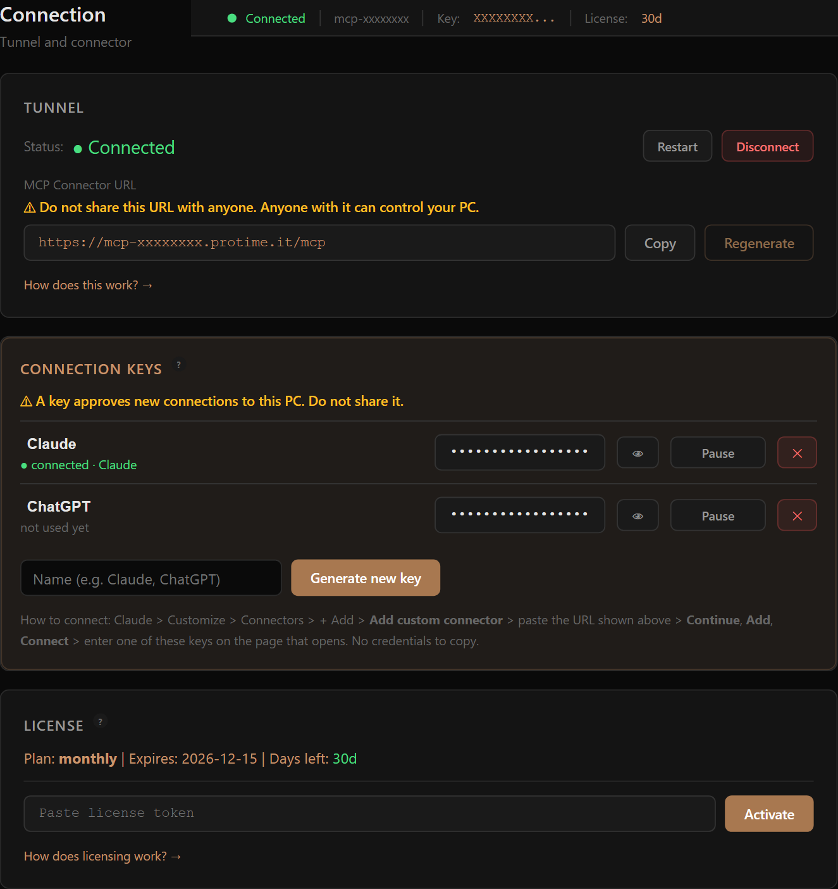
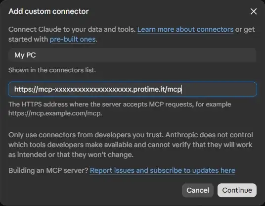

# MCP DeskManager
> Remote MCP server for Windows: control your PC from Claude or ChatGPT — terminal, files, your real Chrome and desktop apps.

**MCP DeskManager** turns a Windows PC into a remote MCP (Model Context Protocol) server.
Install it on the machine you want to control, paste its private address into Claude or ChatGPT
as a custom connector, and the assistant can operate that computer: in Claude from every chat — web, desktop and the phone apps —
and in ChatGPT from chatgpt.com on the web.
No port forwarding, no fixed IP, no config files to edit.

👉 **[Start the free 7-day trial](https://protime.it/en/deskmanager/prova/)** (no card) · [Product page, plans and download → protime.it](https://protime.it/en/deskmanager/)

---

## Install in 10 minutes

1. **Download** the installer from [protime.it/en/deskmanager/download](https://protime.it/en/deskmanager/download/) and run it: it installs itself and opens the setup.
2. **Accept** the license agreement and click **Install** next to each missing component (Cloudflare tunnel, browser profile).
3. **Sign in with Google** (it links your PCs, phone and licenses) and add the license key you received by email.
4. **Copy** the MCP URL and a Connection Key from the last screen. On the Connection page, create one key per assistant.
5. **Claude**: Customize → Connectors → + Add → Add custom connector. Enter a name, paste the MCP URL, click **Continue**, then **Add** and **Connect**, and paste the Connection Key on the page served by your PC. It works in every Claude chat: web, desktop and the phone apps.
6. **ChatGPT** (optional, on the web): turn on developer mode, open chatgpt.com/plugins → + → **Add custom MCP server**, paste the same MCP URL with OAuth, click **Create as a plugin**, and use a different Connection Key.

Full guide with every screenshot: [Install MCP on Windows: 4 methods (2026)](https://protime.it/en/deskmanager/blog/install-mcp-server-windows-easy/)

Unlike screenshot-driven computer use, DeskManager exposes **structured tools**: the assistant calls functions and reads real output instead of guessing pixels. Desktop programs are driven through Windows UI Automation.

---

## The tools

| Tool | What the assistant can do |
|---|---|
| `terminal_executor` | Run PowerShell / CMD / WSL commands, background jobs, services |
| `terminal_reader` | Read the output of running or finished commands, wait for a word, a port or a file |
| `file_reader` | Read any format: text, code, PDF, DOCX, XLSX, images, SQLite |
| `file_writer` | Write, edit, copy, move, download — previous versions are kept |
| `browser_action` | Drive a dedicated browser **or** your real logged-in Chrome |
| `browser_reader` | Read pages, list interactive elements, full-page screenshots |
| `software_action` | Launch and control desktop apps via Windows UI Automation |
| `software_reader` | Inspect windows, UI elements, installed programs, monitors |
| `email_reader` | IMAP: inbox, search, threads, folders |
| `email_writer` | SMTP: send, reply, forward, attachments — always confirmed before sending |
| `phone` | Your paired Android phone: notifications, files, questions, approvals, timers, watchers on long jobs |
| `panel` | An interactive card inside the chat (file browser, gallery, chart, form) that the assistant builds for the task |
| `system` | Sessions, CPU/RAM/GPU monitoring, desktop screenshots, health checks |
| `help` | Built-in reference for every tool |

**Your own Chrome.** With the free [Browser Bridge extension](https://chromewebstore.google.com/detail/mcp-deskmanager-browser-b/fmfdkjnbmfboljohnimcdoicgffdbapp) the assistant can use the Chrome you already use, with your logins, in a tab of its own — and every sign-in asks for your confirmation.

**Persistent sessions.** Terminal tabs survive between messages and keep their working directory and environment.

---

## Security

- **Runs where you decide** — your desktop, an office workstation or your own Windows VPS. The product *is* the server: it lives on your machine, not ours.
- **Private address** published nowhere, behind **OAuth** with a Connection Key you paste on a page served by your own PC.
- **Encrypted tunnel**: nothing is exposed on your router — no open ports, no inbound firewall rules.
- **One key per assistant**, each with its own switch: disconnect ChatGPT without touching Claude.
- **Approval required** for irreversible operations; normal deletes go to the Recycle Bin; secrets typed into commands are masked.

---

## Requirements

- Windows 10 or 11 (64-bit)
- **Claude**: custom connectors are available on every plan (Free: one custom connector)
- **ChatGPT**: a plan with developer mode (Plus, Pro, Business, Enterprise, Edu), used from chatgpt.com on the web
- About 10 minutes for setup

Current plans and prices: **[protime.it/en/deskmanager](https://protime.it/en/deskmanager/#pricing)**

---

## Guides

- [Install MCP on Windows: 4 methods (2026)](https://protime.it/en/deskmanager/blog/install-mcp-server-windows-easy/)
- [Control your PC with Claude: every way compared (2026)](https://protime.it/en/deskmanager/blog/control-windows-pc-from-claude-chat/)
- [Claude Computer Use vs MCP: which to use (2026)](https://protime.it/en/deskmanager/blog/claude-computer-use-vs-remote-mcp-server/)
- [ChatGPT MCP on Windows: connect your PC (2026)](https://protime.it/en/deskmanager/blog/chatgpt-mcp-windows/)
- [MCP server on Windows: every option compared](https://protime.it/en/deskmanager/blog/remote-mcp-server-windows-no-port-forwarding/)
- [Control your PC from your phone with AI](https://protime.it/en/deskmanager/blog/control-pc-from-phone-with-ai/)
- [Documentation](https://protime.it/en/deskmanager/docs/) · [Download](https://protime.it/en/deskmanager/download/)
- For AI agents: [`llms.txt`](https://protime.it/llms.txt) · [`llms-full.txt`](https://protime.it/llms-full.txt) · [guide for AI assistants](https://protime.it/en/deskmanager/ai/)

## Support

Open an issue in this repository, or use the chat assistant on [protime.it](https://protime.it/en/deskmanager/).

---

## About

Built and maintained by **[Protime](https://protime.it/en/)**, an independent software studio in Italy.
This repository hosts documentation and issue tracking: MCP DeskManager is a commercial product and its source code is not distributed.
